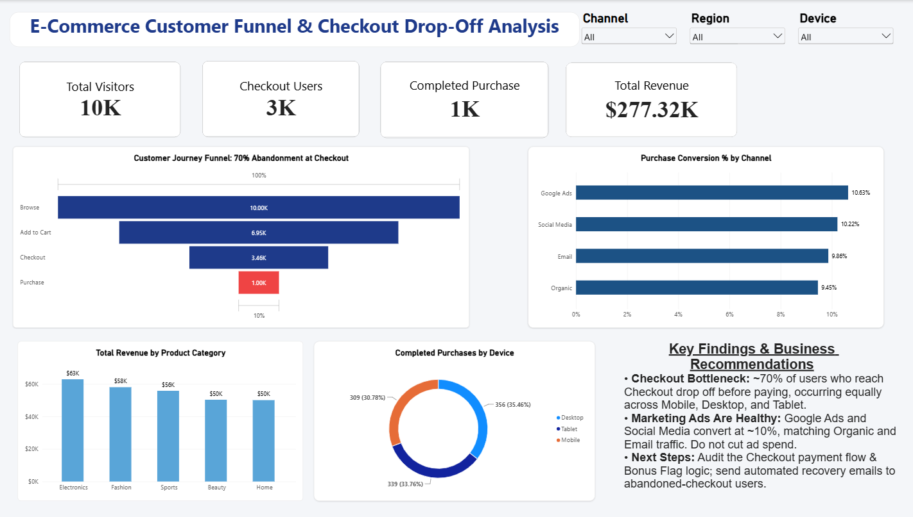

# 📊 E-Commerce Customer Funnel & Checkout Drop-Off Analysis (SQL + Power BI)

## 📌 Business Problem
Marketing was driving strong website traffic via **Google Ads** and **Social Media**, yet final purchases remained low. Leadership needed to know:
* Are paid marketing campaigns wasting budget?
* Where in the shopping journey (`Browse → Add to Cart → Checkout → Purchase`) are customers dropping off?

## 🛠️ Tools & Workflow
* **SQLite (DB Browser for SQL):** Built a non-volatile `clean_funnel` table from 10,000+ user sessions—standardizing column schemas, trimming whitespace, removing duplicate events, and casting revenue fields.
* **Power Query & Power BI:** Created custom conditional sorting for funnel stages, wrote DAX measures for step-by-step conversion rates, and designed an interactive executive dashboard with dynamic slicers (`Channel`, `Region`, `Device`).

## 🔍 Key Findings
* **Paid Ads Are Performing Well:** Google Ads (**10.63%**) and Social Media (**10.22%**) achieved the highest conversion rates, outperforming Organic (**9.45%**) and Email (**9.86%**).
* **70% Abandonment at Checkout:** Out of **3.46K** users who reached Checkout, only **1.00K** completed a purchase (generating **$277.32K** in revenue).
* **Device-Agnostic Friction:** Checkout drop-offs occurred evenly across Desktop (**35.4%**) and Mobile (**33.7%**), indicating checkout page friction or promo/bonus flag drop-offs rather than a single-device bug.

## 💡 Business Recommendations
1. **Maintain Paid Ad Spend:** Do not pause Google Ads or Social Media campaigns, as traffic volume and conversion quality are strong.
2. **Audit the Checkout Page:** Investigate payment gateway errors, surprise shipping fees, and promo/bonus flag logic between Checkout and Purchase.
3. **Launch Abandoned-Checkout Recovery:** Trigger automated email/push reminders for users who reach Checkout without completing payment.
